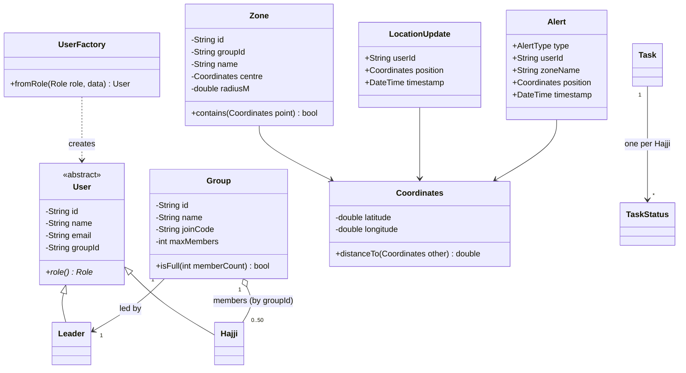

# HajjMate: Technical Requirements Document

| Version | Last updated | Author |
|---|---|---|
| 1.0 | 24 November 2026 | Md. Sazzad Hossain |

> **Note:** This is a living document. Decisions here may change as the code is written. When one changes, update this file. Product scope lives in [PRD.md](PRD.md); the ordered task list lives in `ROADMAP.md`.

## 1. Purpose

This document explains **how** HajjMate is built: architecture, folder structure, the object model, data storage, security rules, packages and the main technical risks. It answers the "what" of [PRD.md](PRD.md) with concrete technical decisions. The guiding rule is **minimal but standard**: no extra layers, no code that is not needed, and every part explainable in a few sentences.

## 2. Architecture

Clean Architecture with three layers inside each feature, and BLoC for state.

```
Presentation (widgets, BLoC)  ──depends on──▶  Domain (entities, repository interfaces, use cases)
Data (models, data sources, repository implementations)  ──depends on──▶  Domain
```

| Layer | Contains | May import |
|---|---|---|
| **Domain** | Entities, repository interfaces, use cases, failures | Pure Dart only (no Flutter, no Firebase) |
| **Data** | Models (JSON/Firebase conversion), data sources, repository implementations | Domain, Firebase and other packages |
| **Presentation** | Screens, widgets, BLoC (events and states) | Domain, Flutter, `flutter_bloc` |

**Dependency rule:** arrows point inward to the domain. The domain never knows Firebase exists; this is the Dependency Inversion Principle in practice.

**Data flow (example: creating a zone):**
`ZoneFormScreen` → `ZoneFormBloc` → `CreateZoneUseCase` → `ZoneRepository` (interface) → `FirestoreZoneRepository` → Cloud Firestore.

### 2.1 Decisions

| # | Decision | Reason |
|---|---|---|
| 1 | **Use cases:** one class per action, implementing `IUseCase<Input, Output>` | Single Responsibility; matches the industry-style reference project. BLoC stays thin. |
| 2 | **Errors:** `Either<Failure, T>` (`dartz`) with an abstract `Failure` hierarchy | Errors are explicit return values; the hierarchy shows inheritance and polymorphism. |
| 3 | **Dependency injection:** `get_it`, registered by hand in one file | No code generation; one file shows which implementation serves which interface. |
| 4 | **Entities and models are separate** (`Zone` vs `ZoneModel`) | The domain stays free of Firebase; only the model knows how to read and write a Firestore document. |
| 5 | **Interface names have no `I` prefix** (`ZoneRepository`); implementations name the technology (`FirestoreZoneRepository`) | Dart style guide; the implementation name says where data goes. |
| 6 | **Routing:** `go_router` | Role-based redirect after login (leader and Hajji go to different home screens). |
| 7 | **Maps:** `flutter_map` with OpenStreetMap tiles | Free, no API key or billing. Limit: the public OSM tile server is not meant for heavy production traffic, so the tile source may change before a store release. |

## 3. Folder structure

Feature-first, with the three layers inside each feature.

```
lib/
  main.dart
  firebase_options.dart            (generated by FlutterFire)
  src/
    core/
      constants/                   default group id, limits (zone radius, max zones)
      errors/                      failures.dart, error_handler.dart
      interfaces/                  IUseCase
      di/                          injection.dart (get_it registrations)
      router/                      app_router.dart
      theme/
    shared/
      widgets/                     buttons, loading and error views
    features/
      auth/        data/ domain/ presentation/
      map/         data/ domain/ presentation/     (live group map)
      zones/       data/ domain/ presentation/     (zone CRUD and geofence registration)
      alerts/      data/ domain/ presentation/     (geofence callback, notifications, alert list)
      tracking/    data/ domain/ presentation/     (location sharing, foreground service)
      groups/      ...                             (Demo 2)
      checklist/   ...                             (Demo 2)
      sos/         ...                             (Demo 2)
test/
  src/                             mirrors lib/src
```

Each feature contains:

```
<feature>/
  data/
    models/          *_model.dart
    datasources/     *_datasource.dart
    repositories/    firestore_*_repository.dart
  domain/
    entities/
    repositories/    abstract repository interfaces
    usecases/        one class per action
  presentation/
    bloc/            *_bloc.dart, *_event.dart, *_state.dart
    screens/
    widgets/
```

## 4. Object-oriented model

The domain model is where OOP and SOLID are most visible. All classes below are pure Dart.

### 4.1 Class diagram



`Task` and `TaskStatus` belong to Demo 2. `AlertType` is an enum: `enter`, `exit`, `sos`.

Membership is stored **once**, as the `groupId` on each user. `Group` does not keep a member list; it only knows the cap and answers `isFull(memberCount)`.

### 4.2 Interfaces (abstract classes)

| Interface | Purpose | Implementation(s) |
|---|---|---|
| `AuthRepository` | Sign in, sign out, current user, save role | `FirebaseAuthRepository` |
| `ZoneRepository` | Create, update, delete, watch zones | `FirestoreZoneRepository` |
| `LocationRepository` | Publish own location, watch group locations | `RealtimeLocationRepository` |
| `AlertRepository` | Publish alert, watch alerts | `RealtimeAlertRepository` |
| `TaskRepository` | Tasks and per-Hajji status (Demo 2) | `FirestoreTaskRepository` |
| `DeviceLocationProvider` | Where the phone's own GPS position comes from | `GeolocatorDeviceLocationProvider` (a no-op version for web) |
| `GeofenceRegistry` | Register zones with the operating system | `NativeGeofenceRegistry` |
| `Notifier` | Show a notification | `LocalNotifier` |

### 4.3 OOP and SOLID mapping

| Principle / concept | Where it shows |
|---|---|
| **Abstraction** | Repository, `DeviceLocationProvider`, `GeofenceRegistry` and `Notifier` interfaces hide Firebase and plugins |
| **Inheritance** | `User` → `Leader`, `Hajji`; `Failure` → `NetworkFailure`, `AuthFailure`, etc. |
| **Polymorphism** | Code handles a `User` or a `Failure` without checking the exact subclass; `Notifier` can be swapped |
| **Encapsulation** | `Zone` keeps centre and radius private, validates the radius (minimum 100 m) in its constructor, and exposes `contains()`; `Group` owns the 50-member cap rule |
| **Composition** | `Zone` has a `Coordinates`; `Group` has members; BLoCs have use cases |
| **Single Responsibility** | One use case per action; a model only converts data; a datasource only talks to Firebase |
| **Open/Closed** | A new `Notifier` (for example FCM push later) is added without editing existing code |
| **Liskov Substitution** | Any `ZoneRepository` implementation (including a test fake) can replace another |
| **Interface Segregation** | Small repositories (`ZoneRepository`, `AlertRepository`) instead of one large data class |
| **Dependency Inversion** | BLoCs and use cases depend on interfaces; `get_it` wires the implementations in one place |

### 4.4 Design patterns

| Pattern | Where |
|---|---|
| **Repository** | `ZoneRepository` and the others: one place that hides where data lives |
| **Factory** | `UserFactory.fromRole()` builds `Leader` or `Hajji` from stored data |
| **Strategy** | `Notifier`: the way a user is notified can be swapped |
| **Observer** | Firestore and Realtime Database streams; BLoC states observed by widgets |

## 5. Data storage

Two Firebase products on the free Spark plan:

- **Realtime Database**: data that changes constantly (live locations, alerts). No per-write limit.
- **Cloud Firestore**: data that changes rarely (users, groups, zones, tasks).

**Every record carries a `groupId`.** In Demo 1 it is always `"default"` (a constant in `core/constants`). Demo 2 reads it from the user's profile.

### 5.1 Cloud Firestore

| Collection | Document fields | Notes |
|---|---|---|
| `users/{uid}` | `name`, `email`, `role` (`leader` or `hajji`), `groupId`, `createdAt` | Created on first sign-in, after the user picks a role |
| `groups/{groupId}` | `name`, `joinCode`, `leaderId`, `createdAt` | Demo 1 uses a single `default` group; real groups in Demo 2 |
| `zones/{zoneId}` | `groupId`, `name`, `latitude`, `longitude`, `radiusM`, `createdBy`, `createdAt` | Max 10 per group; radius at least 100 m (default 150 m) |
| `tasks/{taskId}` (Demo 2) | `groupId`, `title`, `createdBy`, `createdAt` | |
| `tasks/{taskId}/status/{uid}` (Demo 2) | `done`, `updatedAt` | One document per Hajji |

### 5.2 Realtime Database

```
locations/{groupId}/{uid}   → { name, latitude, longitude, timestamp }
alerts/{groupId}/{alertId}  → { type, userId, userName, zoneId, zoneName, latitude, longitude, timestamp }
```

- Each user **overwrites** their own `locations/{groupId}/{uid}` every 30–60 s, so storage does not grow.
- Alerts are **appended** and kept; the leader's alert list shows all of them (it can be limited to the latest N later).
- The path is `locations/{groupId}/{uid}` (not `locations/{uid}`) so the leader listens to one path for the whole group and rules stay simple.

## 6. Security rules

These are **sketches**. Final rules are written and tested together with each feature.

**Known limitations** (the app works normally; these matter only if someone deliberately misuses it):

1. Without Cloud Functions or custom claims (both need the paid plan), the `role` is chosen by the user and stored in their own `users` document. Hardening needs a server.
2. Any signed-in user can write to `alerts/{groupId}`. The rules do not check that the alert's `userId` matches the writer, or that the writer belongs to that group, so a fake alert is possible. The Firebase key is public (as it always is in a mobile app) and anyone can register, so "signed in" does not mean "trusted". Acceptable for Demo 1; closed in Demo 2 (section 6.3).

### 6.1 Firestore (Demo 1)

```
rules_version = '2';
service cloud.firestore {
  match /databases/{database}/documents {
    function signedIn() { return request.auth != null; }
    function isLeader() {
      return signedIn() &&
        get(/databases/$(database)/documents/users/$(request.auth.uid)).data.role == 'leader';
    }

    match /users/{uid} {
      allow read: if signedIn();
      allow create, update: if signedIn() && request.auth.uid == uid;
    }
    match /zones/{zoneId} {
      allow read: if signedIn();
      allow create, update, delete: if isLeader();
    }
  }
}
```

### 6.2 Realtime Database (Demo 1)

```
{
  "rules": {
    "locations": {
      "$groupId": {
        ".read": "auth != null",
        "$uid": { ".write": "auth != null && auth.uid === $uid" }
      }
    },
    "alerts": {
      "$groupId": {
        ".read": "auth != null",
        "$alertId": { ".write": "auth != null && !data.exists()" }
      }
    }
  }
}
```

### 6.3 Demo 2 (multi-tenant)

Rules add a group check: a user reads and writes only data whose `groupId` matches their own, and only a leader writes zones and tasks. For alerts, the rule also requires `userId == auth.uid` and group membership, which closes limitation 2 above. The Realtime Database cannot read Firestore, so group membership is mirrored in the Realtime Database for its rules. Join-code validation happens in the app because there is no server; this is a known weak point and is documented rather than hidden.

## 7. Location, geofencing and background work

This is the riskiest part of the app (PRD stories 4 and 5).

### 7.1 Flow

1. **Hajji's phone** registers every zone with `native_geofence` (enter and exit triggers). This lives in the `zones` feature (`GeofenceRegistry` and `NativeGeofenceRegistry`).
2. When the OS reports an enter or exit, a top-level callback (`@pragma('vm:entry-point')`) runs, even if the app is in the background. It: initializes Firebase and the notification plugin (a background isolate does not start with them), shows a local notification to the Hajji, and writes an `Alert` to `alerts/{groupId}`. The callback runs in its own isolate where `get_it` is not set up, so it creates the few objects it needs directly (`RealtimeAlertRepository`, `LocalNotifier`) instead of using the registrations. This code lives in the `alerts` feature.
3. **Leader's phone** listens to `alerts/{groupId}`. A new alert shows a local notification and appears in the alert list. Every alert stays in the list, so a missed notification can still be seen.
4. In parallel, the Hajji's phone publishes its location to `locations/{groupId}/{uid}` every 30–60 s, so the leader's map stays current.

### 7.2 Background execution

`flutter_foreground_task` runs a foreground service so Dart code keeps working in the background:

- **Hajji:** publishes location on a timer.
- **Leader:** keeps the alerts listener alive.

The foreground service shows a persistent notification while tracking is on ("tracking is on" in PRD terms).

### 7.3 Reference

The geofence part follows the pattern of an earlier project (`field-track`, which registers geofences with `native_geofence` and notifies from the callback). That project is one-sided (no server writes from the callback, no exit alert, no foreground location service), so these three parts are new here.

### 7.4 Platform and limits

- Android first. Geofencing, background location and notifications do not run on web; guard with `kIsWeb` or a no-op `DeviceLocationProvider`.
- Up to 50 Hajjis and 10 zones per group; location update every 30–60 s; zone radius at least 100 m (default 150 m).

## 8. Packages

Versions are chosen when each package is added (`flutter pub add`) and checked against the current Flutter SDK.

| Purpose | Package |
|---|---|
| State management | `flutter_bloc`, `equatable` |
| Error handling | `dartz` |
| Dependency injection | `get_it` |
| Routing | `go_router` |
| Firebase | `firebase_core`, `firebase_auth`, `google_sign_in`, `cloud_firestore`, `firebase_database` |
| Map | `flutter_map`, `latlong2` |
| Location and geofence | `geolocator`, `native_geofence`, `permission_handler` |
| Background service | `flutter_foreground_task` |
| Notifications | `flutter_local_notifications` |
| Localization (Demo 2) | `flutter_localizations`, `intl` |
| Testing (dev) | `flutter_test`, `mocktail`, `flutter_lints` |

## 9. Testing

Tests are written **with** each feature, not at the end, and kept small.

- Structure mirrors the app: `test/src/features/<feature>/domain/usecases/..._test.dart`.
- **What is tested:** domain entities (for example `Zone.contains`, radius validation, `Group` cap), and use cases with mocked repositories (`mocktail`).
- **What is not tested:** UI screens and Firebase itself.
- Geofencing and background behaviour are checked by hand on real phones.

## 10. Developer decisions and conventions

Rules the developer follows (and expects from any assistant), applied everywhere.

### 10.1 Working rules

- **The AI assistant never commits or pushes.** Only the developer runs `git add`, `git commit` and `git push`.
- After each finished sub-task the assistant suggests one short commit message; the developer decides and commits.
- The developer builds the project; the assistant helps and explains, so every part can be explained by the developer.

### 10.2 Coding conventions

**Comments:** keep them to a minimum: one short comment, just long enough to understand. Good names make the code say *what* it does; a comment is only for *why*: a workaround, a platform limit, a surprising condition or a business rule that the code cannot show. No comment that repeats the code. A one-line doc comment on a public interface is fine when its name alone is not clear.

**Naming**
- Files `snake_case`, classes `PascalCase`, variables and methods `camelCase`.
- Interfaces have plain names (`ZoneRepository`); implementations start with the technology (`FirestoreZoneRepository`).
- Use cases `verb_noun_use_case.dart`; BLoC files `name_bloc.dart`, `name_event.dart`, `name_state.dart`.

**Structure**
- One main class per file. Keep classes and methods small, with a single job.
- Split a large screen into small widgets instead of one long `build` method.
- Domain imports no Flutter or Firebase; presentation never imports data. Use `package:` imports.

**Dart style**
- Entities are immutable: `final` fields, `const` constructors, `Equatable`.
- Prefer named parameters when a function takes more than two.
- No `dynamic`, and no `!` (null assertion) without a reason.
- No magic numbers or hardcoded colours in widgets: limits go in `core/constants`, colours and text styles in the theme. All colours live in one theme definition and widgets read them from the theme, so a dark theme can be added later in one place without touching the screens.

**Errors:** repositories return `Either<Failure, T>` and do not throw across layers; every BLoC has loading, success and failure states.

**Before every commit:** `dart format`, `flutter analyze` clean, tests pass. No commented-out code and no `print`.

**Packages:** do not add a new package without a reason written in the commit message.

## 11. Git workflow

- **Commits:** Conventional Commits with a scope, `type(scope): short imperative description`, for example `feat(zone): add radius edit`.
- **Direct to `main`:** project setup and documentation.
- **Feature work:** one branch per sub-task (`feat/zone-crud`), merged into `main` with a pull request. Normal merge (not squash), so the small commits stay in the history.
- `main` should always build and run.

## 12. Risks and open items

| # | Item | Plan |
|---|---|---|
| 1 | Writing to Realtime Database from the geofence callback (background isolate) is untested here | First sub-task of the Roadmap: a small spike on a real Android phone |
| 2 | A foreground service for both roles must survive battery-saving settings on real phones | Same spike; document phone settings if needed |
| 3 | Role is self-declared and alerts are not checked against the writer (no server) | Accepted for Demo 1; alert check added in Demo 2 (section 6) |
| 4 | Join-code validation without a server (Demo 2) | Revisit when Demo 2 starts |
| 5 | Public OpenStreetMap tiles are not for heavy production use | Change tile source before a store release |
| 6 | The path `locations/{groupId}/{uid}` differs from the earlier idea `locations/{uid}` | Confirm during review |
